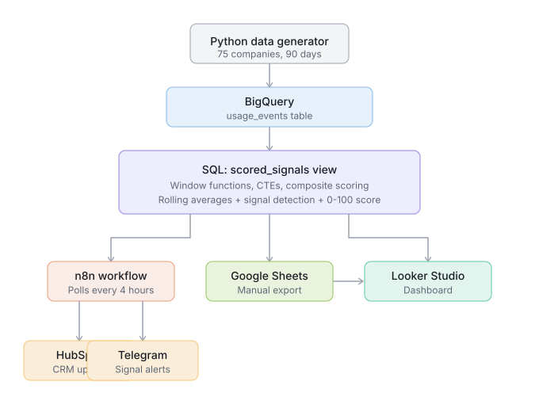

# GTM Signal Engine

A go-to-market signal detection system that identifies expansion-ready B2B SaaS accounts from product usage data. Scores accounts with a weighted composite algorithm using BigQuery SQL (window functions, CTEs, CASE logic), then routes high-priority accounts to HubSpot CRM with Telegram alerts via an n8n workflow.

Built as a portfolio project to demonstrate SQL data pipeline skills in a GTM/RevOps context.

## The Problem

Sales teams waste time guessing which accounts to call. Product usage data holds the answer, but it sits in a warehouse where nobody looks at it. This system automates the decision by monitoring three expansion signals and scoring every account every day.

## How Scoring Works

Three signals are detected from daily product usage events:

| Signal | What It Detects | Weight | SQL Technique |
|--------|----------------|--------|---------------|
| Usage Spike | DAU exceeds 2x the 7-day rolling average | 40 pts | `AVG() OVER (ROWS BETWEEN 6 PRECEDING AND CURRENT ROW)` |
| Seat Crunch | More than 80% of purchased seats in use | 35 pts | `SAFE_DIVIDE(seats_used, seats_purchased)` |
| Feature Milestone | Company has adopted 10+ product features | 25 pts | `MAX() OVER (UNBOUNDED PRECEDING)` cumulative max |

Accounts triggering multiple signals get a multiplier: 1.2x for two signals, 1.3x for three. Final score is capped at 100.

| Score Range | Tier | Action |
|-------------|------|--------|
| 85-100 | CRITICAL | HubSpot + urgent Telegram alert |
| 70-84 | HOT | HubSpot + Telegram alert |
| 50-69 | WARM | HubSpot only |
| 0-49 | COLD | No action |

With current weights, possible scored outcomes are:

```
All 3 signals:       (40+35+25) x 1.3 = 100  CRITICAL
Spike + Crunch:      (40+35) x 1.2    =  90  CRITICAL
Spike + Milestone:   (40+25) x 1.2    =  78  HOT
Crunch + Milestone:  (35+25) x 1.2    =  72  HOT
Any single signal:   max 40                   COLD
```

## Architecture



```
Python generates CSV  -->  BigQuery (usage_events table)
                                    |
                           SQL View: scored_signals
                           (window functions, CTEs, composite scoring)
                                    |
                   +----------------+----------------+
                   |                |                |
              n8n Workflow    Google Sheets     Looker Studio
              (every 4 hrs)   (manual export)    (dashboard)
                   |
            +------+------+
            |             |
        HubSpot       Telegram
        (upsert)      (alerts)
```

## Project Structure

```
gtm-signal-engine/
├── README.md
├── .gitignore
├── sql/
│   ├── 01_rolling_averages.sql        # 7-day rolling averages with window functions
│   ├── 02_signal_detection.sql        # Signal flags using CTEs
│   ├── 03_composite_scoring.sql       # Weighted scoring with multiplier
│   └── 04_create_scored_view.sql      # BigQuery view (latest score per company)
├── scripts/
│   ├── generate_data.py               # Synthetic data generator (uniform, v1)
│   ├── generate_data_v2.py            # Varied data generator (mixed tiers, v2)
│   └── requirements.txt
├── n8n/
│   └── GTM_Signal_Engine.json         # n8n workflow (import-ready)
├── data/
│   └── sample_usage_events.csv        # Sample CSV (try it yourself)
└── docs/
    └── architecture.svg               # System diagram
```

## SQL Highlights

The SQL is the core of this project. Four queries build on each other:

### 1. Rolling Averages (Window Functions)

```sql
-- 7-day rolling average of daily active users, partitioned by company
AVG(daily_active_users) OVER (
    PARTITION BY company_id
    ORDER BY event_date
    ROWS BETWEEN 6 PRECEDING AND CURRENT ROW
) AS dau_7d_avg
```

### 2. Signal Detection (CTEs + Boolean Logic)

```sql
-- Usage spike: today's DAU is more than 2x the 7-day average
(dau_7d_avg > 0 AND daily_active_users > dau_7d_avg * 2) AS has_usage_spike,

-- Seat crunch: utilization above 80%
(seat_utilization_pct > 80) AS has_seat_crunch,

-- Feature milestone: cumulative feature count hits 10+
(max_features_cumulative >= 10) AS has_feature_milestone
```

### 3. Composite Scoring (CASE + Multiplier)

```sql
-- Weighted base score from individual signals
(CASE WHEN has_usage_spike THEN 40 ELSE 0 END)
+ (CASE WHEN has_seat_crunch THEN 35 ELSE 0 END)
+ (CASE WHEN has_feature_milestone THEN 25 ELSE 0 END) AS base_score,

-- Multi-signal multiplier rewards accounts with multiple signals
CASE
    WHEN signals_firing >= 3 THEN 1.3
    WHEN signals_firing = 2 THEN 1.2
    ELSE 1.0
END AS multiplier

-- Final: LEAST(100, ROUND(base_score * multiplier))
```

### 4. Latest Score View (ROW_NUMBER)

```sql
-- Pick only the most recent day per company for the n8n poll
ROW_NUMBER() OVER (
    PARTITION BY company_id
    ORDER BY event_date DESC
) AS row_num
-- WHERE row_num = 1
```

## Tech Stack

| Component | Tool | Cost |
|-----------|------|------|
| Data Warehouse | BigQuery Sandbox | Free |
| SQL Scoring | BigQuery SQL (window functions, CTEs, CASE) | Free |
| Data Generation | Python + Faker + Pandas | Free |
| Workflow Orchestration | n8n (self-hosted on DigitalOcean) | $6/mo (existing) |
| CRM | HubSpot Free (3 custom properties) | Free |
| Alerts | Telegram Bot API | Free |
| Dashboard | Looker Studio + Google Sheets | Free |

Total additional cost: $0

## Try It Yourself

1. Download `data/sample_usage_events.csv` from this repo
2. Create a BigQuery Sandbox project (free, no billing needed)
3. Upload the CSV as a table named `usage_events` in a dataset called `gtm_signals`
4. Copy `sql/04_create_scored_view.sql`, replace `{PROJECT_ID}` with your project ID, run it
5. Query the view: `SELECT * FROM your_project.gtm_signals.scored_signals WHERE signal_score >= 50 ORDER BY signal_score DESC`

You should see ~29 accounts scored across CRITICAL and HOT tiers.

## Live Links

- **Dashboard**: [Looker Studio](https://datastudio.google.com/reporting/fb13f007-f483-4c44-a8b1-f3c2e506354f)
- **Showcase**: [signal.autothynk.com](https://signal.autothynk.com) *(coming soon)*

## Skills Demonstrated

- SQL: Window functions (`AVG OVER`, `MAX OVER`, `ROW_NUMBER`), CTEs, CASE statements, `SAFE_DIVIDE`, composite scoring, BigQuery views
- BigQuery/GCP: Cloud data warehouse, service accounts, sandbox tier
- n8n: Workflow orchestration, BigQuery polling, conditional routing, batch processing, error handling
- HubSpot API: Contact upsert, custom properties, CRM automation
- Python: Synthetic data generation with behavioral archetypes
- Data Pipeline: End-to-end from raw events to scored CRM contacts with real-time alerts

## Author

**Utkarsh Kapoor**
MBA Student, ABV-IIITM Gwalior | Founder, [Autothynk](https://autothynk.com)
